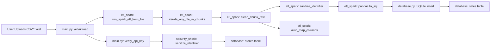

# Backend File Dependency Map

## File Structure Overview
```
backend/
├── main.py              # Entry point & API server
├── database.py           # SQLite schema & data access
├── etl_spark.py          # Data processing & cleaning engine
├── security_shield.py    # Security middleware & utilities
└── test_main.py          # Test suite
```

## Dependency Graph

### main.py (Entry Point)
- **Imports**: database.py, etl_spark.py, security_shield.py
- **Uses**: DB_PATH from database.py, run_spark_etl from etl_spark.py, CyberArmorMiddleware from security_shield.py
- **Calls**: init_db() (database), verify_api_key() (security), run_spark_etl_from_file() (etl)

### database.py (Data Layer)
- **Provides**: DB_PATH constant, init_db() function, SQLite connection logic
- **Used by**: main.py (for all DB operations), etl_spark.py (for inserting cleaned data)
- **Creates**: ecommerce.db with tables: stores, sales

### etl_spark.py (Processing Engine)
- **Provides**: iterate_any_file_in_chunks(), clean_chunk_fast(), run_spark_etl_from_file()
- **Uses**: pandas, database.DB_PATH, security_shield.sanitize_identifier()
- **Calls**: database.py for SQL inserts via pandas.to_sql()

### security_shield.py (Security Layer)
- **Provides**: CyberArmorMiddleware, sanitize_identifier(), hash_secret()
- **Used by**: main.py (middleware), etl_spark.py (input validation)
- **Protects**: All API endpoints and data processing

### test_main.py (Testing)
- **Imports**: main.py, fastapi.testclient
- **Tests**: All security features, authentication, data isolation

## Data Flow: File Upload → Database



## API Request Flow


## Key Integration Points

1. **Startup Sequence**: main.py → init_db() → database.py creates tables
2. **Upload Processing**: main.py → etl_spark → database insertion
3. **Security**: Every request passes through security_shield middleware
4. **Data Validation**: etl_spark calls security_shield.sanitize_identifier() before DB insert
5. **Testing**: test_main.py imports main.py to verify all integrations work

## Failure Scenarios

- Missing etl_spark.py: ❌ No data processing, upload crashes
- Missing security_shield.py: ❌ No authentication/security, SQL injection possible
- Missing database.py: ❌ No data storage, all queries fail
- Missing test_main.py: ⚠️ Tests won't run but app still works

The files form a circular dependency where each layer depends on the next, creating a secure, validated data pipeline from file upload to analytics-ready database."